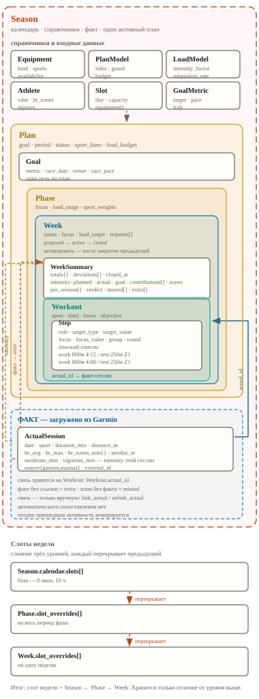

# Модель домена — спецификация

Coach App · v4.4 · 22 сущностей · 53 инвариантов (53 подтверждено) · 5 вопросов

> **Источник правды:** этот MD-файл. HTML — производная: `python3 tools/render_spec.py`.
> Правки вносятся здесь, HTML пересобирается.

## 1 · Диаграмма сущностей



Вложенность = владение. Пунктир красный — переопределение слота или сопоставление план↔факт. Пунктир серый — ссылка на справочник. Блок «ФАКТ» — данные, приходящие извне плана.

## 2 · Сущности

### Season  *(корень)*

- `id` · `horizon{start,end,season_week_count}`
- `calendar.slots[]` — дефолтные слоты
- `equipment[]` · `plan_models[]` · `load_model`

### Plan  *(aggregate)*

- `id` · `status{active,completed,draft}`
- `goal` — одна цель плана
- `period{start,end}`
- `sport_lines{sport → {model_ref, weight}}`
- `load_budget{hours_range,normalized_min_range,intensity_pct_max}`
- `phase_ids[]` · `transition{overlap_weeks,reason}`

### Goal  *(value)*

- `id` · `discipline` · `race_date` · `venue` · `start_time`
- `metric{type,target,target_friendly}`
- `race_pace_min_per_km` · `realistic_fork{best,likely,conservative}`

### Phase  *(aggregate)*

- `id` · `objective` — цель фазы текстом («набрать беговой объём»). Не путать с `Plan.goal` — это цель плана (10К за 40:00)
- `load_range` · `volume_range` · `intensity_pct_mean` · `deload_weeks[]`
- `sport_weights{}` — распределение внутри фазы
- `slot_overrides[]`

### MacroWeek  *(value)*

Неделя макро-плана: что в неделе задумано, до всякой раскладки. Не `Week` — неделя это конкретное расписание с запросами и шагами, а макро-неделя строка плана на весь сезон.

- `season_week` · `phase_id` — фаза, в которую неделя попадает
- `focus` · `goal_text` — что развиваем: «Развиваем VO2max»
- `run_km` · `total_h` · `sessions_target` · `deload`
- Хранится одна на неделю сезона, включая будущие: план известен целиком, а не по мере наступления недели
- Факта у макро-недели нет: он живёт в `Week.summary`. Неделя сезона без закрытой `Week` — факта не имеет

**Описание недели — про объём, а не про цель одной тренировки.**

`goal_text` макро-недели — это **описание недели**: «Набираем 56 км за 9 тренировок · работа по плану». Раньше оно бралось из цели качественной работы (`quality.goal_text` — «Проверяем форму на контрольной точке»), и это вводило в заблуждение: неделя с контрольной точкой читалась как «неделя про тест», и по такой подписи каждая пробежка недели выглядела подготовкой к нему.

Цель адаптации и описание недели — разные вещи: первая про то, что развиваем, второе про то, сколько набираем. Описание собирается из километража и числа тренировок, масштаб — из положения километража относительно диапазона фазы.

### Week  *(aggregate)*

Три состояния. Расписание не обязано быть жёстким: что не разложилось — остаётся висеть и ждёт решения.

- `plan_id` · `season_week` · `start,end`
- `status{proposed,active,closed}`
- `focus` — адаптационная цель недели
- `load_target{hours,distance_m,sessions,intensity_pct,normalized_min}`
- `requests[]` — намерения из макро
- `assignments[]` — что разложилось по слотам
- `unplaced[]` — висяки: не разложилось, ждёт решения пользователя. Без привязки к дню, учитываются в плане недели. **С деталями**: название, объект, шаги, «зачем» — по тренировке запроса, чтобы по висяку можно было открыть экран тренировки, как по размещённой
- `workouts[]` — тренировки со счётом шагов; могут быть уже в `proposed`
- `summary` → `WeekSummary`

### WeekSummary  *(value)*

Итог недели: что планировали против того, что сделали. Живёт и обновляется по мере выполнения; окончательно фиксируется при закрытии недели.

- `week_id` · `closed_at` · `updated_at`
- `totals{planned,actual,delta_pct}` — по часам, дистанции, нагрузке
- `per_session[]` — сопоставление: `{request_id, actual_id, verdict}`
- `verdict{done,partial,missed,extra,substituted}` — по каждой сессии
- `missed[]` · `extra[]` — не запланированное, но сделанное
- `deviations[]` — `{metric,planned,actual,reason}`
- `intensity{planned_moderate,actual_moderate,planned_vigorous,actual_vigorous,goal_min}` — интенсивность: план, факт, цель
- `intensity.contributions[]` — `{actual_id, moderate_min, vigorous_min}`: из чего сложился факт
- `intensity.zones{moderate_bpm_low,moderate_bpm_high,vigorous_bpm_low,vigorous_bpm_high}` — пороги источника; приоритет — зоны атлета
- `intensity.sources[]` — `garmin`
- `metrics{}` — метрики формы недели: зоны пульса, темп в зоне, нагрузка, форма, каденция. Считаются при закрытии недели

### ActualSession  *(value)*

Что фактически сделано. Одна запись на выполненную тренировку: объём, пульс и intensity minutes. Живёт вне плана; связан с планом через `Workout.actual_id`. Всё не связанное всё равно учитывается в actuals.

- `id` · `date` · `sport{run,bike,swim,hiit,strength,ofp,mobility}` · `duration_min` · `distance_m`
- `hr_avg` · `hr_max` · `hr_zones_min{}` — минуты по зонам атлета
- `aerobic_te` · `anaerobic_te` · `vo2max`
- `moderate_min` · `vigorous_min` — intensity minutes тренировки от источника; если источник не делит — всё в moderate
- `source{garmin,manual}` · `external_id` — id активности Garmin, уникален
- `fetched_at` — когда вытянуто из источника
- `linked_workout_id` — обратная ссылка, ставится вручную; null = факт без плана, но он всё равно в actuals

### WorkoutDetail  *(value)*

Разбор выполненной тренировки: агрегаты, отрезки, зоны пульса и ряды для графика. Источник — FIT-файл Garmin, парсится адаптером. Факт ссылается на разбор, а не наоборот: разбор — производная от факта.

| поле | тип | смысл |
|---|---|---|
| `actual_id` | str | факт, к которому относится разбор |
| `source` | FactSource | GARMIN |
| `duration_s` / `elapsed_s` | float | время в движении / общее |
| `distance_m` | float | дистанция |
| `ascent_m` / `descent_m` | float | набор и сброс высоты |
| `avg_hr` / `max_hr` | int? | пульс средний и максимальный |
| `avg_cadence` / `max_cadence` | int? | каденция средняя и максимальная |
| `avg_power_w` / `max_power_w` / `normalized_power_w` | int? | мощность |
| `calories` | int? | калории |
| `hr_zone_minutes` | dict[str, float] | минуты в зонах пульса атлета |
| `cadence_source` | str? | `stryd` (ремень) или `watch` (часы) |
| `power_source` | str? | `stryd` или `garmin` |
| `splits` | list[Split] | отрезки (лапсы Garmin) |
| `series_hr` / `series_cadence` / `series_power` / `series_distance` | list[tuple[int, float]] | ряды для графика: (секунда, значение) |

### Split  *(value)*

Отрезок тренировки: лапс Garmin.

| поле | тип | смысл |
|---|---|---|
| `index` | int | номер отрезка |
| `duration_s` | float | длительность |
| `distance_m` | float | дистанция |
| `avg_hr` / `max_hr` | int? | пульс |
| `avg_cadence` | int? | каденция |
| `avg_speed_mps` | float? | средняя скорость |
| `ascent_m` | float? | набор высоты |

### Command  *(command)*

Любое изменение состояния. Ничего не меняется само — только по команде.

- `id` · `type` — `propose_week · activate_week · close_week · replan_remainder · link_actual · unlink_actual · place_unplaced · unplace_request · add_composed_workout · remove_workout`
- `target{week_id, ...}` · `args{}`
- `reason` · `issued_at` · `issued_by{user,brain}`
- `status{proposed,applied,rejected}` · `diff[]`

**Удаление тренировки — только пока неделя не активна.**

`remove_workout` работает для `proposed`-недели: план ещё можно переделать,
и пользователь убирает то, что не получилось. В `active`-неделе удалять
нельзя (план исполняется, а связь с фактом порвалась бы), в `closed` —
нельзя тем более (I23: закрытая неделя не меняется). Удаляются вместе с
тренировкой её запрос и её размещение — иначе остался бы запрос без
тренировки.

**Тренировка из текста — команда `add_composed_workout`.**

Разбор текста пожеланий — не команда, а чтение: он ничего не меняет.
Добавление разобранной тренировки в неделю — уже изменение состояния,
поэтому команда. Тренировка добавляется **висяком**: время и окно
выбирает пользователь, система ничего за него не решает.

### WorkoutIntent  *(value)*

Намерение одного шага тренировки — то, что возвращает модель, разбиравшая
текст пожеланий.

- `role{warmup,work,rest,cooldown,transition}` · `sport`
- `target_type{distance,time}` · `target_value` — объём, который назвал человек
- `intent` — интенсивность словами: `easy · long · marathon · steady · threshold · interval · repetition`
- `label` · `reps` · `notes` · `rest_type` · `rest_value`

**Модель отвечает за структуру, домен — за числа.**

Модель говорит «разминка → работа → заминка», «фартлек», «8 км». Зону
пульса, темп и длительность считает домен — по профилю атлета и таблице
Дэниэлса. Если бы модель придумывала числа, ошибки шли бы оттуда,
где их быть не должно, и их нельзя было бы отличить от ошибок домена.

Детерминированного парсинга нет: текст живой, и разбирать его должна
модель, а не набор правил.

**Намерение едет вместе с разбором.** `Composition` возвращает список
намерений (`intents`) рядом с готовыми шагами: без него повторы и отдых
пришлось бы угадывать по шагам, и они терялись бы при добавлении
тренировки в неделю.

**Короткий повтор — это повторный темп (R), а не интервальный (I).**
Модель называет «интервал» любой повторный отрезок, но «6 по 200 через
200» по методике Дэниэлса — это R: темп I медленнее, и работа получается
медленнее названного. Граница — 600 м: до неё отрезок держится в темпе
«на старт», после — это уже интервальная работа.

### Request  *(value)*

- `id` · `sport` · `kind` · `focus`
- `duration_min` · `equipment_required[]`
- `priority` · `min_slot_quality`
- статуса нет — состояние выводится: размещён (есть Assignment) или висит (в `unplaced[]`)

### Assignment  *(value)*

- `request_id` · `slot_id` · `start` · `duration_min`
- `equipment` · `fit_score`
- статуса нет — факт выполнения живёт в `Workout.status`

### Slot  *(value)*

- `id` · `day` · `start,end` · `capacity_min`
- `equipment[{equipment_id}]`
- `constraints{max_intensity,forbidden_sports,note}`
- `priority_hint`

**Место определяет, что в окне возможно.** У окна есть `location` — асфальт, стадион, бассейн, станок дома. Из места выводится `forbidden_sports`: велотренажёра на асфальте нет, бассейна дома тоже нет. Правило живёт в `app/domain/slot_rules.py` и выражено **запретами**, а не разрешениями: всё, что не запрещено, в этом месте возможно.

Планировщик день и время больше не назначает, но привязка руками — тоже решение пользователя, поэтому запрет **не блокирует** выбор: окно помечается «не подходит» и остаётся доступным.

| место | чего там нет |
|---|---|
| `asphalt_commuter` · `stadium` · `home` · пусто (улица) | велосипеда, бассейна |
| `stadium_or_pool` · `pool_or_asphalt` | велосипеда |
| `home_stationary_bike` · `long_ride_or_station` | бассейна |
| неизвестное место | ничего не запрещено |

### SlotOverride  *(patch)*

- `slot_id` · `ops[]{remove,set_time,set_capacity,add_equipment,remove_equipment,set_constraints,add}`
- `reason` · `scope{season,phase,week}`

### Workout  *(value)*

- `id` · `request_id` → `Request` — из какого намерения выросла
- `sport` · `kind` · `focus`
- `objective{metric,target}` · `objective.name` — **название тренировки**
- `equipment[]` · `location` · `time`
- `steps[]` · `priority` · `status{planned,done,skipped,moved}` · `rationale`
- `actual_id` → `ActualSession` — связь с фактом, ставится вручную
- `feedback{}` — субъективная оценка тренировки (см. ниже); пусто — оценки нет

**Километраж тренировки — производная от шагов.**

Тренировка не хранит дистанцию: метры живут в шагах с `target_type=distance`.
Километраж считается как сумма таких шагов (`workout_distance_m`) — включая
отдых на бегу, это тоже пройденные метры. Шаги без дистанции (разминка по
времени, силовая) вклад не дают: метры оттуда неизвестны.

Ноль означает «дистанция не задана», а не «тренировка нулевая»: показывать
ноль километров бессмысленно. В плашке тренировки километраж стоит рядом с
длительностью — «1 ч 18 мин · 14,3 км», потому что «55 мин» ничего не
говорит о том, длинная это тренировка или нет.

**Название тренировки — из её состава.**

`objective.name` собирается из шагов тренировки, а не из фокуса запроса: основа (лёгкий бег, длинный бег, качественная работа) плюс то, что в ней есть, — отрезки, ОФП. «Лёгкий бег + отрезки + ОФП», «Лёгкий бег», «Длинный бег», «Темповый тест 3К».

Фокус запроса — цель тренировки, и он копировался в каждую тренировку недели: все семь пробежек назывались «Проверяем форму на контрольной точке». По такому названию нельзя отличить лёгкую пробежку от длинной. Название из состава с содержимым разойтись не может: нет отрезков — нет и слова «отрезки». Правило — в `app/domain/session_name.py`.

**Длительность карточки = сумма шагов** (инвариант I5). Шаг с дистанцией согласован со своим темпом: 14.0 км @ 5:40 — это 80 минут. Карточка и внутренность тренировки не могут показывать разное.

**Темп лёгкого бега — «E» текущей формы плюс 12 секунд**, а не «E» из таблицы Дэниэлса: «E» — верх лёгкой зоны (для VDOT 48 это 5:28); на длинной дистанции в нём HR упирается в верх Z2, и «лёгкий бег» перестаёт быть лёгким. Середина зоны — плюс 12 секунд (при VDOT 48 это 5:40, при VDOT 49 — 5:35).

**Правило одно на все места, где встречается лёгкий бег:** восстановление между отрезками, основная часть пробежки, длинный бег. Темпы отрезков и тестов не трогаем.

**Почему смещение, а не константа.** Темп 5:40 был решением по спортсмену от 18.11.2026, когда форма была VDOT 48. Но 5:40 — это не отдельное число, а 328 + 12: смещение от зоны «E». Зашитая константа перестаёт соответствовать спортсмену при смене формы — лёгкий бег остался бы на прежнем темпе, план разошёлся бы с формой, а карточка профиля показывала бы одно, а план другое. Поэтому темп считается от текущей формы (инвариант I52).

**Неделя собирается из четырёх источников.**

Порядок сборки (Кирилл, 18.11.2026):

1. **Недельный километраж** — из макро-плана сезона.
2. **Скелеты качественных тренировок и ограничения по объёму** — из
   программы Дэниэлса («R-темп — не более 5 % недельного километража»,
   «I-темп — 8 % или 10 км, что меньше»).
3. **Объём качественных сессий** — планируется с учётом ограничений:
   лишнее снимается с самой объёмной работы в зоне.
4. **Остаток недели** — лёгкий бег по 5:40 на километр.
5. **Число беговых сессий** — из профиля атлета (`runs_per_week`).
   Длинная пробежка, качественные работы и контрольная точка входят в
   это число. У атлета их **шесть**: в неделю лучшей работы (три
   качественные + длинная) остаток лёгкого не помещается в три пробежки
   по 5 км — сессия короче 5 км не делается, поэтому лёгких выходит
   две.

**Сессия короче 5 км не делается.** Остаток, который в 5 км не влезает,
идёт в следующую пробежку: 9 км на две сессии — это 5+5, а не 4,5+4,5.

**Число серий качественной работы — по объёму недели.** Правило: «количество
серий определяется так, чтобы общий объём в повторном темпе был примерно
5 % недельного километража или чуть больше», и то же для интервального —
«примерно 8 %». В справочнике задан **вид** серии, а сколько раз её
повторить — следствие недельного километража. Рецепты с этим правилом
помечены директивой `reps_by_volume`.

**Предел зоны — с допуском.** «Не более 5 %» в книге и «примерно 5 % или
чуть больше» в рабочем правиле — разные вещи: без допуска работа
выбрасывалась целиком из-за лишних сотен метров. Допуск задаётся в
справочнике рядом с долей (`cap | R 0.05 t1.2`).

**Разминка и заминка — отдельные шаги тренировки.** Перед качественной
работой — разминка минимум 3 км, после — заминка минимум 1 км, в лёгком
темпе, расстоянием. Они **вне** наборов работы: разминка не кусок серии
и в объём серии не входит.

**Недельный километраж — расстоянием, а не временем.** Длинная пробежка
и лёгкие пробежки заданы шагом с дистанцией; шаг со временем переводится
в километры по темпу своей зоны. Иначе неделя выглядит короче, чем она
есть, и не сходится с макро.

**ОФП — отдельными тренировками**, их можно поставить в любой день.

**В неделю контрольной точки качественная работа — это тест.** Программа
Дэниэлса на этой неделе отступает: иначе неделя называет два разных
темпа — темп теста и темп программы.

**Вид работы программы читается по-русски**: «Работа в повторном темпе»,
«Работа в пороговом темпе», «Работа в интервальном темпе». Код зоны (`r`,
`t`, `i`) в карточке не читается.

### Step  *(value)*

- `role{warmup,work,rest,cooldown,transition}`
- `sport` · `target_type{time,distance,laps,reps,open}` · `target_value` — длительности в минутах; для силовой/ОФП — общая длительность тренировки, округлённая до минут
- `focus{pace,hr,power,rpe,none,strength_pattern}` · `focus_value{}`
- `group` · `round`
- `label` · `notes`

**Повторы — это круги, а круг — это работа + отдых.** «6 по 200 через
200» разворачивается в шесть кругов, и в каждом круге два блока: работа
(200 м по 3:35) и отдых (200 м по 5:40). Отдых есть и в последнем
круге: иначе объём набора не сходится с тем, что человек пробежал
(6 × 400 = 2400 м, а не 1200).

**Набор — один блок.** У шагов набора одна `group`: «6×200м через 200м»
и «5×400м» — разные наборы с разными названиями. Название собирается
из самого набора (`N×объём через отдых`), а не берётся из названия
тренировки: иначе два разных набора получили бы одну подпись и клиент
склеил бы их в один блок.

**Круг (`round`) — номер повтора внутри набора.** `round=1` после
`round=2` означает начало нового набора, даже если название совпало.
В `focus_value` шага набора: `set_reps` (число кругов), `set_blocks`
(число блоков в круге), `set_block` (номер блока в круге).

### Equipment  *(реестр)*

- `id` · `name` · `kind{track,water,machine,route,vehicle}`
- `sports[]` · `availability{days,valid_until,seasonal_note}`
- `limitations{max_distance_m,needs_booking,surface}`

### Athlete  *(value)*

- `vdot` · `hr_zones{zone → bpm}` · `hr_max,rhr,lth`
- `injuries[]` · `form`
- `ftp_w` — пороговая мощность, Вт. Нужна для нагрузки (TSS): нагрузка считается от мощности относительно порога. Без порога нагрузка не считается — метрика не появляется
- `runs_per_week` — сколько беговых сессий в неделю. Число беговых тренировок недели берётся отсюда, а не из макро: макро хранит объём, а форма недели — свойство спортсмена. Ноль — профиль не задан
- Темпы на текущей форме и названия зон пульса — **не поле профиля**, а производные: темпы считаются по `vdot` из справочника Дэниэлса, названия зон — по коду зоны. В профиле их нет, потому что хранить вторым экземпляром нельзя, а названия зон — слова про зоны атлета, а не про его пульс

### PlanModel  *(стратегия)*

- `id` · `name` · `version` · `sports[]`
- `inputs{}` · `intensity_map{}` · `intensity_units[]`
- `block_rules{}` · `progression_rules{}` · `guard{}`
- `description` — текстовое описание модели

### LoadModel  *(правило)*

- `intensity_factor{zone → доля VO2max}`
- `adaptation_rate{sport → коэффициент}` — единственный владелец (в Athlete нет)
- `formula` · `budget{}`

## 3 · Связи

### Владение и ссылки

| Откуда | Куда | Тип | Кардинальность |
|---|---|---|---|
| Season | Plan | владение | 1 → N; ровно 1 active |
| Season | Slot | дефолт | 1 → N |
| Season | Equipment | реестр | 1 → N |
| Season | LoadModel | реестр | 1 → 1 |
| Plan | Goal | владение | 1 → 1 |
| Plan | PlanModel | ссылка | N → N |
| Plan | Phase | владение | 1 → N |
| Plan | MacroWeek | макро-план | 1 → N |
| Plan | Week | владение | 1 → N |
| Phase | SlotOverride | перекрытие | 1 → N |
| Season | Command | журнал | 1 → N |
| Command | Week | применение | N → 1 |
| Week | Request | владение | 1 → N |
| Week | SlotOverride | перекрытие | 1 → N |
| Week | Assignment | владение | 1 → N |
| Request | Assignment | ссылка | 1 → 0..1 |
| Request | Workout | детализация | 1 → 0..1 |
| Assignment | Slot | размещение | N → 1 |
| Slot | Equipment | доступность | N → N |
| Week | Workout | владение | 1 → N |
| Week | WeekSummary | итог | 1 → 0..1 |
| WeekSummary | Request | ссылка | N → 0..1 |
| WeekSummary | ActualSession | вклад в интенсивность | N → 1 |
| Season | ActualSession | факт | 1 → N |
| Workout | ActualSession | связь план↔факт | 0..1 → 1 |
| Workout | Step | владение | 1 → N |
| Step | Equipment | требование | N → N |
| Athlete | Step / PlanModel | вход | 1 → N |
| LoadModel | Step | вход | 1 → N |

### Наследование слотов

| Уровень | Источник | Что делает |
|---|---|---|
| Season | `calendar.slots[]` | базовое окно: день, время, ёмкость, оборудование |
| Phase | `slot_overrides[]` | перекрытие на весь период фазы |
| Week | `slot_overrides[]` | перекрытие на одну неделю |

Итог: `Season ← Phase ← Week`, каждое перекрытие применяется последним. Patch хранит только отличие от уровня выше.

### Инварианты

| # | Правило |
|---|---|
| I1 | В сезоне ровно один Plan со статусом `active` ✓ |
| I2 | Слот определён на уровне сезона; фаза и неделя его перекрывают; неделя может добавить свой ✓ |
| I3 | Ссылка слота — на существующее оборудование из реестра ✓ |
| I4 | В тренировке один `sport`; все шаги этого спорта ✓ |
| I5 | Σ длительностей шагов = длительность тренировки ✓ |
| I6 | Шаги не пересекаются по времени; `rest` идёт после `work` ✓ |
| I7 | Запрос без размещения попадает в `unplaced` с причиной ✓ |
| I8 | У недели со статусом `closed` есть `WeekSummary` ✓ |
| I9 | `Workout.actual_id` и `ActualSession.linked_workout_id` указывают друг на друга ✓ |
| I10 | Связь 1:1 — один факт ↔ одна тренировка, и наоборот ✓ |
| I11 | `actual_id` ставится только через `link_actual`, вручную ✓ |
| I12 | Всё, что попало в план до активации, — планирование; без связи с фактом к закрытию ⇒ `missed` ✓ |
| I13 | Факт без плановой сессии ⇒ `linked_workout_id = null`; он всё равно учитывается в actuals ✓ |
| I14 | Активности берутся только из Garmin ✓ |
| I15 | Автоматического сопоставления нет: связь ставится только вручную ✓ |
| I16 | `summary.intensity.actual_moderate` = Σ `summary.intensity.contributions[].moderate_min` по факту недели ✓ |
| I17 | Вклад в неделю принимается только из факта с датой в её диапазоне ✓ |
| I18 | Один факт — один вклад в неделю ✓ |
| I19 | Статус недели меняется только через `Command` ✓ |
| I20 | Каждый `Workout` вырос из `Request` (`request_id` задан) ✓ |
| I21 | Повторный `propose_week` полностью заменяет содержимое `proposed`-недели ✓ |
| I22 | `replan_remainder` меняет только тренировки без факта; с фактом — не трогает; план не пересобирается, тренировка с фактом не удаляется ✓ |
| I23 | Закрытая неделя не меняется; поздний факт игнорируется ✓ |
| I24 | Неделя закрывается только по команде; сама не закрывается ✓ |
| I25 | Переносов между неделями нет: тренировка не переходит из недели в неделю ✓ |
| I26 | Висяки (`unplaced[]`) учитываются в плане недели ✓ |
| I27 | Intensity minutes берутся только из тренировок; нет тренировок — нет intensity minutes ✓ |
| I28 | Недельные агрегаты Garmin (пн→вс) не используются — считаем сами по тренировкам ✓ |
| I29 | Если источник не делит интенсивность — всё в `moderate` ✓ |
| I30 | Неделя без факта показывается с нулями; причины низких цифр не учитываются ✓ |
| I31 | Висяк (`unplaced[]`) не привязан к дню ✓ |
| I32 | Размещение висяка решает пользователь — вручную ✓ |
| I33 | Неделя гонки принадлежит плану ✓ |
| I34 | Планы не перекрываются ✓ |
| I35 | Длительности силовой и ОФП — общая длительность тренировки, округлённая до минут ✓ |
| I36 | `Plan.goal` и `Phase.objective` — разные вещи, не дублируют друг друга ✓ |
| I37 | У Request и Assignment нет статуса — состояние выводится из наличия Assignment ✓ |
| I38 | Висящая тренировка без факта ⇒ пропущена ✓ |
| I39 | `replan_remainder` делит неделю по факту, а не по календарной дате ✓ |
| I40 | Повторный propose переделывает план; выполненное с фактом остаётся на месте ✓ |
| I41 | План готовит propose для одной следующей недели ✓ |
| I42 | `external_id` уникален (id активности Garmin) ✓ |
| I43 | Единственный `adaptation_rate` — в `LoadModel` ✓ |
| I44 | Связь факта и тренировки хранится с обеих сторон: `Workout.actual_id` и `ActualSession.linked_workout_id` ✓ |
| I45 | Активировать неделю можно только после закрытия предыдущей; планировать следующую можно до её закрытия ✓ |
| I46 | Метрики формы считаются только из разбора FIT; без разбора метрик нет ✓ |
| I47 | Нагрузка (TSS) считается только при заданном `ftp_w` ✓ |
| I48 | Темп в зоне пульса — без отдыха: отдых отсекается по каденции ✓ |
| I49 | Темпы в карточке профиля считаются по текущей форме (VDOT) из справочника Дэниэлса; без формы темпов нет ✓ |
| I50 | Нагрузка сезона — сумма TSS по неделям с фактом; считается заново из разборов FIT, поэтому не зависит от того, когда неделю закрыли. Неделя без нагрузки не считается неделей с нулевой нагрузкой; средние делятся на недели с нагрузкой, а не на все недели сезона ✓ |
| I51 | Незакрытая неделя не тянет средние нагрузки вниз: в ней нагрузка ещё не вся. Сумма при этом включает всё сделанное — сделанное не обнуляется тем, что неделя ещё не закрыта ✓ |
| I52 | Темп лёгкого бега — производная от текущей формы: зона «E» по таблице Дэниэлса плюс 12 секунд на километр. Не зашитое число: при росте формы лёгкий бег ускоряется сам, иначе план разошёлся бы с карточкой профиля ✓ |
| I53 | Оценка тренировки живёт на тренировке, а не на факте: факт перезаписывается выкачкой (`upsert` пишет сессию целиком), а оценку ставят один раз и потом правят. Пересборка недели возвращает выполненные тренировки на место — оценка переезжает вместе с ними ✓ |

Отметка `✓` = подтверждено Кириллом. При подтверждении правится эта отметка, не текст правила.

### Решения по вопросам

Зафиксированные ответы Кирилла. Действуют как правила модели.

| Вопрос | Решение |
|---|---|
| Методология подсчёта TSS | тикет — tsybriki/coach#6. Референс: Training Stress Scores (TSS) Explained |
| Дисбаланс sport_lines | пользователь руками |
| Единицы длительности | силовую и ОФП — общая длительность тренировки, округлять до минут |
| Цель плана vs цель фазы | разные вещи: `Plan.goal` — «10К за 40:00», `Phase.objective` — «набрать беговой объём» |
| Статус Request и Assignment | статуса нет — состояние выводится: размещён (есть Assignment) или висит (в `unplaced[]`) |
| `external_id` | уникален — id активности Garmin |
| Висящая тренировка в итогах | нет факта — пропущена |
| Граница replan_remainder | по факту: с фактом — не трогаем, без факта — снова планируемо. План не пересобирается |
| Wipe при повторном propose | переделывает план; выполненное (с фактом) остаётся на месте — факт это сделанная работа |
| Сколько недель планировать наперёд | одну |
| Перекрытие планов | не перекрываются |
| Неделя гонки | плану |
| Висяки | решение за пользователем: остаётся висеть и учитывается в плане недели; без привязки к дню. Факт берётся из факта; при закрытии сравниваем план с фактом |
| Поздний факт | игнорировать |
| Тренировка без факта | нет факта — не выполнено |
| Факт без интенсивности | всё в moderate |
| Intensity minutes | только из тренировок; нет тренировок — нет intensity minutes |
| Граница недели | считать самому — недельные агрегаты Garmin (пн→вс) не используем |
| Неделя без данных | с нулями; всегда показываем фактические цифры, причины не важны |
| Закрытие недели | только по команде, само не закрывается |
| Переносы между неделями | нет — переносов нет; планировать следующую можно и до закрытия текущей |
| Источник активностей | только Garmin |
| Связывание план↔факт | только ручное, 1:1; всё не связанное учитывается в actuals |
| Формат хранения | не доменный вопрос: файлы сейчас, SQLite — по триггерам. Решение в `design/02-хранилище.md` и `design/08-развилки.md` |
| Метрики формы | зоны пульса, темп в зоне, нагрузка (TSS), VO2max, эффективность, каденция. Из разбора FIT; разбор — часть выкачки факта |
| Нагрузка (TSS) | по TrainingPeaks от мощности: `(часы × NP × IF) / FTP × 100`. Только при заданном `ftp_w` |
| Темп в пульсовой зоне | по секундным рядам, отдых отсекается по каденции (< 65) |
| План по новым метрикам | нет — только факт |

### Производные значения

Не хранятся — считаются.

| Значение | Формула |
|---|---|
| Нагрузка тренировки | Σ (минуты шага × intensity_factor(зона) × adaptation_rate(спорт)) — `LoadModel` |
| Нагрузка недели | Σ по тренировкам |
| Итоговые слоты недели | Season ← Phase.patch ← Week.patch |
| Темп шага | PlanModel.intensity_map + Athlete.vdot |
| Границы HR-зон | Athlete.hr_max, rhr, lth |
| Длительность / дистанция тренировки | Σ по шагам |
| Норма недели | Phase недели |
| Итог недели (WeekSummary) | план (requests + load_target) против факта (ActualSession) |
| Прогресс недели («N из M») | `week.load_target` против факта недели: часы, сессии, километраж **бега** (`Sport.RUN`); считается по всем активностям недели, связанным и нет |
| Verdict по сессии | по факту связанной `ActualSession`: полное совпадение, частичное, замена |
| Отклонение недели | факт − план по каждой метрике, с причиной |
| Verdict факта без плана | `extra` — попадает в нагрузку недели, но не в выполнение плана |
| Интенсивность недели | `summary.intensity`: Σ по тренировкам недели; если источник не делит — всё в moderate. Нет тренировок — нет intensity minutes |
| Плановые intensity minutes | расчёт по шагам недели через зоны атлета (решение 7) |
| Граница недели | считаем сами по тренировкам — недельные агрегаты Garmin (пн→вс) не используем |

### Жизненный цикл недели

Три состояния. Всё инициирует пользователь. Изменений назад нет: прошедшие сессии не трогаются, закрытая неделя не переоткрывается.

| Состояние | Что есть | Переход |
|---|---|---|
| `proposed` | план предложил неделю из макро и попробовал разложить по слотам; что не разложилось — в `unplaced` | `propose_week` |
| `active` | разложенные тренировки стоят по слотам; неразложенные висят в `unplaced[]` | `activate_week` |
| `closed` | саммари посчитано и записано; можно планировать следующую | `close_week` |

#### План можно готовить заранее, активировать — нет

Следующую неделю можно **спланировать** до закрытия текущей: `propose_week`
собирает неделю из макро-плана, и ждать закрытия незачем. А вот **активировать**
её до закрытия предыдущей нельзя (I45) — активная неделя это работа, а
пока предыдущая не закрыта, работа не закончена.

Правило живёт в сервисе, а не в маршруте: `activate_week` отказывает, пока
хоть одна более ранняя неделя не закрыта. В ответе недели сервер отдаёт
`can_activate` и `activate_blocked_by` — клиент показывает решение, а не
дублирует правило.

Наперёд планируется **одна** неделя: та, что после текущей по календарю.

#### propose_week — можно вызывать многократно

Планировщик берёт макро фазы и собирает намерения. **Дни и время не назначает** — раскладкой занимается пользователь. Всё, что собрано, уходит в **ручной режим** — `unplaced[]`. Каждый новый propose **вытирает предыдущий**: неделю можно предлагать заново, пока она не активна.

Автоматическая раскладка по слотам была убрана: она угадывала день и время тренировки, но ошибалась — вел вставал в окно, где велосипеда нет, а тренировки без дня сортировались в конец списка. Раскладка по местам и времени — решение пользователя.

**Висяк — два действия, а не одно.**

Тап по строке висяка открывает **экран тренировки**: название, структура, шаги, «зачем» — всё как у размещённой тренировки. Кнопка «привязать» открывает **выбор окна**. Разделение нужно потому, что решить, куда поставить тренировку, нельзя, не видя, что в ней: раньше про висяк известно было только «Лёгкий бег, 46 мин», и выбор окна делался вслепую.

На экране тренировки висяка кнопка привязки тоже есть — выбор окон появляется под ней. Поведение привязки от того, откуда её вызвали, не зависит.

#### activate_week — неделя оживает

Привязанные тренировки стоят по слотам. Непривязанные **остаются висеть** в `unplaced[]` — расписание не обязано быть жёстким. Дальше неделя живёт: тренировки выполняются, факт привязывается, висялки можно разложить позже командой `place_unplaced`.

#### close_week — явный ритуал

Считаем саммари, записываем. После этого неделя закрыта и **не меняется**: ни новый факт, ни поздняя активность её не трогают. Дальше планируется следующая неделя.

#### replan_remainder — переплан остатка

Внутри недели можно запросить перепланирование **остатка**. Деление — **по
факту**, а не по календарной дате: выполненное (к чему привязан факт) не
трогаем, всё остальное снова планируемо. Запрос инициирует пользователь.

Что делает команда:

1. Тренировка **с фактом** остаётся на месте: факт, запрос, размещение и
   сама тренировка. Выполненное не переписывается.
2. Тренировка **без факта** снова планируемая: запрос уходит в `unplaced[]`
   (висяк), размещение снимается, день и окно из карточки убираются —
   иначе тренировка осталась бы и в списке размещённых, и среди висяков.

**План не пересобирается.** Команда отвязывает тренировки без факта от
слотов, чтобы их можно было двигать, — и всё. Пересборка по правилам
методики создаёт тренировки заново, а новые получают те же id, что у
выполненных (`r7-1…r7-6`, `r7-other-*`): в неделе оказывается 10
тренировок вместо 8, с задвоенными id. Удаление идёт по запросу, а у
дубликата и у выполненной запрос один, — «удалить дубликат» сносило
выполненную тренировку вместе с фактом (Кирилл, 22.11.2026).

**Тренировку с фактом удалить нельзя** — ни в какой неделе. Факт — это
сделанная работа, и он не теряется вместе с тренировкой. Проверяется
факт с **обеих** сторон связи (I44): и по `actual_id` тренировки, и по
обратной ссылке факта — стороны могут разъехаться, и тогда тренировку,
которую помнит факт, удаление по одной стороне пропускало.

**Выполненное определяется по обеим сторонам связи.** Связь хранится с
обеих сторон (I44), и они могут разъехаться: после удаления дубликата
факт помнил тренировку, а тренировка — нет. Делить по одной стороне
нельзя: выполненное выглядело бы невыполненным и отвязывалось вместе со
своим фактом. Факт — источник истины (он переживает пересборку плана, а
`actual_id` тренировки — нет), и переплан чинит разрыв: выполненной
тренировке возвращается её факт.

**`unplaced` — это все запросы без размещения, а не «невыполненные».**
Иначе выполненный запрос без размещения выпадает из обеих корзин: его
нет ни среди размещённых, ни среди висяков — и инвариант I7 падает
(«запрос r7-other-3 без размещения не в unplaced»). Такое состояние —
после «Предложить заново»: размещения сброшены, а факты помнят свои
тренировки (Кирилл, 22.11.2026).

**«Предложить заново» не теряет выполненное.** Факт — это сделанная
работа, и перепредложение плана её не отменяет: выполненные тренировки
остаются на месте, со своим фактом и размещением, а их одноимённые
тренировки из пересборки заменяются ими (иначе в неделе снова окажутся
дубликаты id).
3. Неделя возвращается в `proposed` — дальше работает обычный режим
   propose: пересборка по правилам, ручная правка, активация.

Деление по дате было бы неправильным: пропущенная по календарю, но не
выполненная тренировка «зависла» бы в плане, и пользователь не смог бы
её переделать.

**Что из этого следует**

1. Черновик не считается: `proposed` не влияет на расчёт нагрузки до активации.
2. Висяки (`unplaced[]`) допустимы в любом состоянии, включая `active`. Расписание мягкое: лучше оставить тренировку неразложенной, чем насильно приткнуть её в неподходящий слот.
3. Висящая тренировка не выполнена, но и не отменена — она ждёт места. Отличие от `missed` в саммари: `missed` — тренировка стояла по слоту, но не выполнена.
4. Закрытие — всегда ручное действие. Автоматика может предложить, но не закрыть.
5. Никаких отмен и откатов: активированная неделя живёт до закрытия, закрытая — навсегда.

#### Что появляется на каждом шаге

| Шаг | Появляется | Чего нет |
|---|---|---|
| propose_week | `focus`, `load_target`, `requests[]`, `assignments[]`, `unplaced[]`; частично — `workouts[]` | факта |
| activate_week | полный счёт `workouts[]` со `steps[]`, `inputs_version`; висялки остаются | факта |
| факт загружен | `ActualSession[]`, кандидаты на связывание, вклад в `summary.intensity` | итогов |
| связывание подтверждено | `Workout.actual_id`, `verdict` по каждой сессии | — |
| replan_remainder | неделя в `proposed`; выполненное на месте, невыполненное — снова висяки | изменений в выполненном |
| close_week | `summary` финализирован, `deviations[]` | — |

#### Порядок внутри close_week

`вытянуть остаток факта → сопоставить руками → посчитать и записать`. Неподтверждённые сессии не блокируют закрытие — они попадают в саммари как `missed`. Переносов в следующую неделю нет.

### Висяки и план недели

Решение по висякам — **за пользователем**: он остаётся висеть и учитывается в плане недели. Факт всё равно берётся из факта. При закрытии недели сравниваем план с фактом.

### Связывание факта и плана

Автоматического сопоставления нет вообще. Факт и план связывает пользователь, вручную.

**Цель связывания** — сопоставить задачу сессии с её выполнением. Всё, что не связано, в любом случае учитывается в actuals: связывание уточняет отчёт, но не решает, что считать сделанным.

**Активности берутся только из Garmin.** Поздний факт (пришедший после закрытия недели) игнорируется — закрытые недели не трогаются.

| Шаг | Что происходит |
|---|---|
| Загрузка факта | в любой момент можно вытянуть тренировки из Garmin — вручную или по кнопке. Активность → `ActualSession` с её `moderate_min`/`vigorous_min` |
| Связывание | пользователь выбирает факт для конкретной тренировки → `link_actual`: `Workout.actual_id` + `ActualSession.linked_workout_id`, обновляются вместе |
| Отвязывание | `unlink_actual` — если связали не то |
| Пересчёт | изменение связи пересчитывает `WeekSummary` затронутой недели |

### Субъективная оценка тренировки

Оценка снимается **в момент привязки факта** к плановой тренировке и
потом редактируется на уже привязанной тренировке.

Хранится на тренировке (`Workout.feedback{}`), не на факте: факт
перезаписывается выкачкой, а оценку человек ставит один раз.

```json
{
  "body_status": 0,             // 0 — фон, -1 — тянет, -2 — ломает
  "easy_feel": null,            // 1 · 0 · -1 — лёгкая и длинная работа
  "rep1_mental": null,          // fresh · heavy — качественная работа
  "rep2_physical": null,        // opened_up · wooden
  "want_one_more": null,        // yes · enough · definitely_no
  "comment": ""                 // заметка: ветер, недосып, кроссовки
}
```

**Форма зависит от вида работы.** Лёгкая и длинная работа спрашивает
общее ощущение; интервальная, пороговая и повторная — динамику внутри
работы (как зашёл, как разогрелся, хватило ли). Остальные виды спорта
оценки не имеют.

**Вид работы — по шагам, а не по `kind`.** `kind` в данных разный у
разных источников (`easy`, `long`, `quality`, `composed`, а у программы
Дэниэлса — `r`, `t`, `i`), и интервальную тренировку, собранную из
текста, по нему не отличить от лёгкой. Поэтому вид определяется по зоне
работы в шагах (`daniels_zone`, `intent`).

**Пустое значение — «не заполнено», а не «фон».** «Фон» (0) — выбранное
значение; его отсутствие и «фон» — разные вещи. У состояния тела «Фон»
выбран заранее: в обычный день человек ничего не трогает.

**Поля, не относящиеся к виду работы, отбрасываются.** У лёгкой работы
нет «2-го отрезка», у качественной — «общего ощущения». Смена вида
работы (тренировка переехала из лёгкой в пороговую) переключает форму:
сохранённое «общее ощущение» больше не относится к ней.

### Метрики формы

Километраж не показывает форму: «65 км лёгких» и «65 км в пороге» — разные
недели. Метрики формы отвечают на вопрос, какой объём в какой зоне и с какой
интенсивностью сделан.

**Откуда берутся.** Метрики считаются из **разбора FIT**: пульсовые зоны, темп в
зоне, нагрузка и каденция в FIT есть, в факте Garmin — нет (там только
`vo2max` и TE). Поэтому **разбор FIT — часть выкачки факта**: пользователь жмёт
«Загрузить факт из Garmin» и получает не только факт, но и разбор.

Разбор не может сорвать выкачку: если файла нет или он не разобрался,
тренировка остаётся в факте, просто без метрик.

| Метрика | Что это | Откуда |
|---|---|---|
| `z2_min` `z3_min` `z4_min` | минуты в зонах пульса | разбор FIT |
| `hi_min` | минуты в интенсивных зонах (Z5–Z7) | разбор FIT |
| `pace_z2` | темп в Z2 — «какой темп выдерживаю на пульсе до 135» | разбор FIT |
| `tss` | нагрузка по TrainingPeaks | разбор FIT + `ftp_w` |
| `vo2max` | форма по Garmin | факт |
| `efficiency` | темп по форме ÷ фактический темп | разбор FIT + VDOT |
| `cadence_avg` `cadence_work` | каденция: средняя и в рабочей части | разбор FIT |

**Темп в зоне — по секундным рядам, без отдыха.** Garmin делит интервалы на лапы,
и в лапу попадает в том числе отдых. По рядам видно, где человек стоял, а где
бежал: отдых отсекается по каденции (ниже 65 — стоял). Без этого «темп в Z2»
показывал бы темп трубки.

**Нагрузка — по TrainingPeaks:** `TSS = (часы × NP × IF) / FTP × 100`, где
`IF = NP / FTP`. От **мощности**, а не от пульса: FTP — порог мощности, и
пульсовые зоны его не заменяют.

**Без FTP нагрузки нет.** `ftp_w` живёт в профиле атлета. Пока порог не задан,
метрика не появляется — подставлять выдуманное значение нельзя, получится
правдоподобная цифра, которой никто не мерил. Оценку порога по тренировкам
(95-й перцентиль мощности) приложение показывает, но **не записывает сама**:
подтверждает пользователь.

**Где считаются.** Метрики тренировки — из её разбора, доступны сразу после
загрузки факта. Метрики недели — агрегат по тренировкам: считаются **при
закрытии недели** и кладутся в `WeekSummary.metrics`. До закрытия тот же агрегат
считается на лету, чтобы видеть его до закрытия.

**Что показывают — только факт.** Плана по новым метрикам нет: их не из чего
вывести, а показывать «план» значит выдумывать.

### Закрытие недели

Простой явный ритуал, три шага.

**Планирование и выполнение** — всё, что попало в план до активации, считается планированием. Всё, что планировалось, но к моменту закрытия не связано с фактом, — не выполнено.

**Закрытие — только по команде**, само ничего не закрывается. Недель с переносами между собой нет. Планировать следующую неделю можно и до закрытия текущей — ждать не нужно; активировать её можно только после (I45).

| Шаг | Что происходит |
|---|---|
| 1 · вытянуть | достать из Garmin всё, что ещё не вытянуто |
| 2 · сопоставить | связать факт с плановыми тренировками — руками |
| 3 · посчитать | считать цифры и записать в `summary` |

### Неделя в работе

| Момент | Что меняется в неделе |
|---|---|
| Вытянут факт | `ActualSession` появляется в сезоне; вклад в `summary.intensity.contributions[]` не делается, пока факт не связан |
| Факт связан | `link_actual`: `Workout.actual_id` ← факт; статус тренировки → `done`; факт добавляется в `summary.intensity.contributions[]` |
| Неделя закончилась | `close_week` — только по команде: вытянуть остаток факта → сопоставить руками → посчитать и записать. Переносов в следующую неделю нет |

## 4 · Вопросы

1. Как устроен переход между планами? Планы не перекрываются — граница проходит по дате цели. Вопрос: как технически закрывается первый план и открывается второй.
2. Какие виды спорта поддержаны и по каким правилам? Набор PlanModel.
3. На каком расстоянии считается темп? Километр / 100 м / миля — база не задана на уровне модели.
4. Обязаны ли шаги соответствовать фокусу тренировки?
5. Что входит в `inputs_version`? vdot, hr_zones, план, модель, слоты — полный набор не зафиксирован.

---

Coach App · модель домена v4.1
