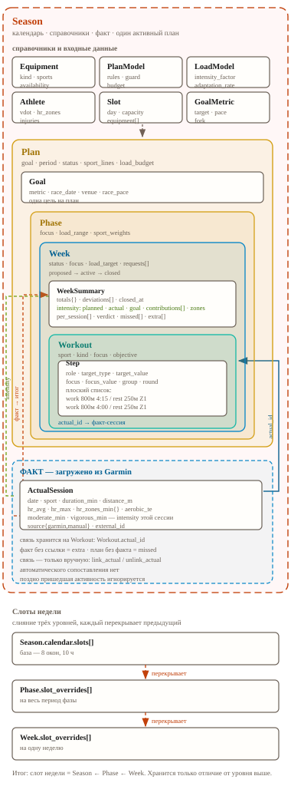

# Модель домена — спецификация

Coach App · v3.6 · 18 сущностей · 43 инвариантов (43 подтверждено) · 6 вопросов

> **Источник правды:** этот MD-файл. HTML — производная: `python3 tools/render_spec.py`.
> Правки вносятся здесь, HTML пересобирается.

## 1 · Диаграмма сущностей

Вложенность = владение. Пунктир красный — переопределение слота или сопоставление план↔факт. Пунктир серый — ссылка на справочник. Блок «ФАКТ» — данные, приходящие извне плана.

## 2 · Сущности

### Season  *(корень)*

- `id` · `horizon{start,end,season_week_count}`
- `calendar.slots[]` — дефолтные слоты
- `equipment[]` · `plan_models[]` · `load_model`

### Plan  *(aggregate)*

- `id` · `status{active,completed,draft}`
- `goal` — одна цель плана
- `period{start,end}`
- `sport_lines{sport → {model_ref, weight}}`
- `load_budget{hours_range,normalized_min_range,intensity_pct_max}`
- `phase_ids[]` · `transition{overlap_weeks,reason}`

### Goal  *(value)*

- `id` · `discipline` · `race_date` · `venue` · `start_time`
- `metric{type,target,target_friendly}`
- `race_pace_min_per_km` · `realistic_fork{best,likely,conservative}`

### Phase  *(aggregate)*

- `id` · `objective` — цель фазы текстом («набрать беговой объём»). Не путать с `Plan.goal` — это цель плана (10К за 40:00)
- `load_range` · `volume_range` · `intensity_pct_mean` · `deload_weeks[]`
- `sport_weights{}` — распределение внутри фазы
- `slot_overrides[]`

### Week  *(aggregate)*

Три состояния. Расписание не обязано быть жёстким: что не разложилось — остаётся висеть и ждёт решения.

- `plan_id` · `season_week` · `start,end`
- `status{proposed,active,closed}`
- `focus` — адаптационная цель недели
- `load_target{hours,distance_m,sessions,intensity_pct,normalized_min}`
- `requests[]` — намерения из макро
- `assignments[]` — что разложилось по слотам
- `unplaced[]` — висяки: не разложилось, ждёт решения пользователя. Без привязки к дню, учитываются в плане недели
- `workouts[]` — тренировки со счётом шагов; могут быть уже в `proposed`
- `summary` → `WeekSummary`

### WeekSummary  *(value)*

Итог недели: что планировали против того, что сделали. Живёт и обновляется по мере выполнения; окончательно фиксируется при закрытии недели.

- `week_id` · `closed_at` · `updated_at`
- `totals{planned,actual,delta_pct}` — по часам, дистанции, нагрузке
- `per_session[]` — сопоставление: `{request_id, actual_id, verdict}`
- `verdict{done,partial,missed,extra,substituted}` — по каждой сессии
- `missed[]` · `extra[]` — не запланированное, но сделанное
- `deviations[]` — `{metric,planned,actual,reason}`
- `intensity{planned_moderate,actual_moderate,planned_vigorous,actual_vigorous,goal_min}` — интенсивность: план, факт, цель
- `intensity.contributions[]` — `{actual_id, moderate_min, vigorous_min}`: из чего сложился факт
- `intensity.zones{moderate_bpm_low,moderate_bpm_high,vigorous_bpm_low,vigorous_bpm_high}` — пороги источника; приоритет — зоны атлета
- `intensity.sources[]` — `garmin`

### ActualSession  *(value)*

Что фактически сделано. Одна запись на выполненную тренировку: объём, пульс и intensity minutes. Живёт вне плана; связан с планом через `Workout.actual_id`. Всё не связанное всё равно учитывается в actuals.

- `id` · `date` · `sport` · `duration_min` · `distance_m`
- `hr_avg` · `hr_max` · `hr_zones_min{}` — минуты по зонам атлета
- `aerobic_te` · `anaerobic_te` · `vo2max`
- `moderate_min` · `vigorous_min` — intensity minutes тренировки от источника; если источник не делит — всё в moderate
- `source{garmin,manual}` · `external_id` — id активности Garmin, уникален
- `fetched_at` — когда вытянуто из источника
- `linked_workout_id` — обратная ссылка, ставится вручную; null = факт без плана, но он всё равно в actuals

### Command  *(command)*

Любое изменение состояния. Ничего не меняется само — только по команде.

- `id` · `type` — `propose_week · activate_week · close_week · replan_remainder · link_actual · unlink_actual · place_unplaced`
- `target{week_id, ...}` · `args{}`
- `reason` · `issued_at` · `issued_by{user,brain}`
- `status{proposed,applied,rejected}` · `diff[]`

### Request  *(value)*

- `id` · `sport` · `kind` · `focus`
- `duration_min` · `equipment_required[]`
- `priority` · `min_slot_quality`
- статуса нет — состояние выводится: размещён (есть Assignment) или висит (в `unplaced[]`)

### Assignment  *(value)*

- `request_id` · `slot_id` · `start` · `duration_min`
- `equipment` · `fit_score`
- статуса нет — факт выполнения живёт в `Workout.status`

### Slot  *(value)*

- `id` · `day` · `start,end` · `capacity_min`
- `equipment[{equipment_id}]`
- `constraints{max_intensity,forbidden_sports,note}`
- `priority_hint`

### SlotOverride  *(patch)*

- `slot_id` · `ops[]{remove,set_time,set_capacity,add_equipment,remove_equipment,set_constraints,add}`
- `reason` · `scope{season,phase,week}`

### Workout  *(value)*

- `id` · `request_id` → `Request` — из какого намерения выросла
- `sport` · `kind` · `focus`
- `objective{metric,target}`
- `equipment[]` · `location` · `time`
- `steps[]` · `priority` · `status{planned,done,skipped,moved}` · `rationale`
- `actual_id` → `ActualSession` — связь с фактом, ставится вручную

### Step  *(value)*

- `role{warmup,work,rest,cooldown,transition}`
- `sport` · `target_type{time,distance,laps,reps,open}` · `target_value` — длительности в минутах; для силовой/ОФП — общая длительность тренировки, округлённая до минут
- `focus{pace,hr,power,rpe,none,strength_pattern}` · `focus_value{}`
- `group` · `round`
- `label` · `notes`

### Equipment  *(реестр)*

- `id` · `name` · `kind{track,water,machine,route,vehicle}`
- `sports[]` · `availability{days,valid_until,seasonal_note}`
- `limitations{max_distance_m,needs_booking,surface}`

### Athlete  *(value)*

- `vdot` · `hr_zones{zone → bpm}` · `hr_max,rhr,lth`
- `injuries[]` · `form`

### PlanModel  *(стратегия)*

- `id` · `name` · `version` · `sports[]`
- `inputs{}` · `intensity_map{}` · `intensity_units[]`
- `block_rules{}` · `progression_rules{}` · `guard{}`
- `description` — текстовое описание модели

### LoadModel  *(правило)*

- `intensity_factor{zone → доля VO2max}`
- `adaptation_rate{sport → коэффициент}` — единственный владелец (в Athlete нет)
- `formula` · `budget{}`

## 3 · Связи

### Владение и ссылки

| Откуда | Куда | Тип | Кардинальность |
|---|---|---|---|
| Season | Plan | владение | 1 → N; ровно 1 active |
| Season | Slot | дефолт | 1 → N |
| Season | Equipment | реестр | 1 → N |
| Season | LoadModel | реестр | 1 → 1 |
| Plan | Goal | владение | 1 → 1 |
| Plan | PlanModel | ссылка | N → N |
| Plan | Phase | владение | 1 → N |
| Plan | Week | владение | 1 → N |
| Phase | SlotOverride | перекрытие | 1 → N |
| Season | Command | журнал | 1 → N |
| Command | Week | применение | N → 1 |
| Week | Request | владение | 1 → N |
| Week | SlotOverride | перекрытие | 1 → N |
| Week | Assignment | владение | 1 → N |
| Request | Assignment | ссылка | 1 → 0..1 |
| Request | Workout | детализация | 1 → 0..1 |
| Assignment | Slot | размещение | N → 1 |
| Slot | Equipment | доступность | N → N |
| Week | Workout | владение | 1 → N |
| Week | WeekSummary | итог | 1 → 0..1 |
| WeekSummary | Request | ссылка | N → 0..1 |
| WeekSummary | ActualSession | вклад в интенсивность | N → 1 |
| Season | ActualSession | факт | 1 → N |
| Workout | ActualSession | связь план↔факт | 0..1 → 1 |
| Workout | Step | владение | 1 → N |
| Step | Equipment | требование | N → N |
| Athlete | Step / PlanModel | вход | 1 → N |
| LoadModel | Step | вход | 1 → N |

### Наследование слотов

| Уровень | Источник | Что делает |
|---|---|---|
| Season | `calendar.slots[]` | базовое окно: день, время, ёмкость, оборудование |
| Phase | `slot_overrides[]` | перекрытие на весь период фазы |
| Week | `slot_overrides[]` | перекрытие на одну неделю |

Итог: `Season ← Phase ← Week`, каждое перекрытие применяется последним. Patch хранит только отличие от уровня выше.

### Инварианты

| # | Правило |
|---|---|
| I1 | В сезоне ровно один Plan со статусом `active` ✓ |
| I2 | Слот определён на уровне сезона; фаза и неделя его перекрывают; неделя может добавить свой ✓ |
| I3 | Ссылка слота — на существующее оборудование из реестра ✓ |
| I4 | В тренировке один `sport`; все шаги этого спорта ✓ |
| I5 | Σ длительностей шагов = длительность тренировки ✓ |
| I6 | Шаги не пересекаются по времени; `rest` идёт после `work` ✓ |
| I7 | Запрос без размещения попадает в `unplaced` с причиной ✓ |
| I8 | У недели со статусом `closed` есть `WeekSummary` ✓ |
| I9 | `Workout.actual_id` и `ActualSession.linked_workout_id` указывают друг на друга ✓ |
| I10 | Связь 1:1 — один факт ↔ одна тренировка, и наоборот ✓ |
| I11 | `actual_id` ставится только через `link_actual`, вручную ✓ |
| I12 | Всё, что попало в план до активации, — планирование; без связи с фактом к закрытию ⇒ `missed` ✓ |
| I13 | Факт без плановой сессии ⇒ `linked_workout_id = null`; он всё равно учитывается в actuals ✓ |
| I14 | Активности берутся только из Garmin ✓ |
| I15 | Автоматического сопоставления нет: связь ставится только вручную ✓ |
| I16 | `summary.intensity.actual_moderate` = Σ `summary.intensity.contributions[].moderate_min` по факту недели ✓ |
| I17 | Вклад в неделю принимается только из факта с датой в её диапазоне ✓ |
| I18 | Один факт — один вклад в неделю ✓ |
| I19 | Статус недели меняется только через `Command` ✓ |
| I20 | Каждый `Workout` вырос из `Request` (`request_id` задан) ✓ |
| I21 | Повторный `propose_week` полностью заменяет содержимое `proposed`-недели ✓ |
| I22 | `replan_remainder` меняет только сессии на сегодня и позже ✓ |
| I23 | Закрытая неделя не меняется; поздний факт игнорируется ✓ |
| I24 | Неделя закрывается только по команде; сама не закрывается ✓ |
| I25 | Переносов между неделями нет: закрываем одну, потом планируем следующую ✓ |
| I26 | Висяки (`unplaced[]`) учитываются в плане недели ✓ |
| I27 | Intensity minutes берутся только из тренировок; нет тренировок — нет intensity minutes ✓ |
| I28 | Недельные агрегаты Garmin (пн→вс) не используются — считаем сами по тренировкам ✓ |
| I29 | Если источник не делит интенсивность — всё в `moderate` ✓ |
| I30 | Неделя без факта показывается с нулями; причины низких цифр не учитываются ✓ |
| I31 | Висяк (`unplaced[]`) не привязан к дню ✓ |
| I32 | Размещение висяка решает пользователь — вручную ✓ |
| I33 | Неделя гонки принадлежит плану ✓ |
| I34 | Планы не перекрываются ✓ |
| I35 | Длительности силовой и ОФП — общая длительность тренировки, округлённая до минут ✓ |
| I36 | `Plan.goal` и `Phase.objective` — разные вещи, не дублируют друг друга ✓ |
| I37 | У Request и Assignment нет статуса — состояние выводится из наличия Assignment ✓ |
| I38 | Висящая тренировка без факта ⇒ пропущена ✓ |
| I39 | `replan_remainder` определяет «сегодня» по календарной дате ✓ |
| I40 | Повторный propose переделывает план; привязки факта пользователь ставит заново ✓ |
| I41 | План готовит propose для одной следующей недели ✓ |
| I42 | `external_id` уникален (id активности Garmin) ✓ |
| I43 | Единственный `adaptation_rate` — в `LoadModel` ✓ |

Отметка `✓` = подтверждено Кириллом. При подтверждении правится эта отметка, не текст правила.

### Решения по вопросам

Зафиксированные ответы Кирилла. Действуют как правила модели.

| Вопрос | Решение |
|---|---|
| Методология подсчёта TSS | тикет — tsybriki/coach#6. Референс: Training Stress Scores (TSS) Explained |
| Дисбаланс sport_lines | пользователь руками |
| Единицы длительности | силовую и ОФП — общая длительность тренировки, округлять до минут |
| Цель плана vs цель фазы | разные вещи: `Plan.goal` — «10К за 40:00», `Phase.objective` — «набрать беговой объём» |
| Статус Request и Assignment | статуса нет — состояние выводится: размещён (есть Assignment) или висит (в `unplaced[]`) |
| `external_id` | уникален — id активности Garmin |
| Висящая тренировка в итогах | нет факта — пропущена |
| Граница replan_remainder | «сегодня» — по календарной дате |
| Wipe при повторном propose | переделывает план; привязки пользователь может поставить заново |
| Сколько недель планировать наперёд | одну |
| Перекрытие планов | не перекрываются |
| Неделя гонки | плану |
| Висяки | решение за пользователем: остаётся висеть и учитывается в плане недели; без привязки к дню. Факт берётся из факта; при закрытии сравниваем план с фактом |
| Поздний факт | игнорировать |
| Тренировка без факта | нет факта — не выполнено |
| Факт без интенсивности | всё в moderate |
| Intensity minutes | только из тренировок; нет тренировок — нет intensity minutes |
| Граница недели | считать самому — недельные агрегаты Garmin (пн→вс) не используем |
| Неделя без данных | с нулями; всегда показываем фактические цифры, причины не важны |
| Закрытие недели | только по команде, само не закрывается |
| Переносы между неделями | нет — закрываем одну, потом планируем следующую |
| Источник активностей | только Garmin |
| Связывание план↔факт | только ручное, 1:1; всё не связанное учитывается в actuals |

### Производные значения

Не хранятся — считаются.

| Значение | Формула |
|---|---|
| Нагрузка тренировки | Σ (минуты шага × intensity_factor(зона) × adaptation_rate(спорт)) — `LoadModel` |
| Нагрузка недели | Σ по тренировкам |
| Итоговые слоты недели | Season ← Phase.patch ← Week.patch |
| Темп шага | PlanModel.intensity_map + Athlete.vdot |
| Границы HR-зон | Athlete.hr_max, rhr, lth |
| Длительность / дистанция тренировки | Σ по шагам |
| Норма недели | Phase недели |
| Итог недели (WeekSummary) | план (requests + load_target) против факта (ActualSession) |
| Verdict по сессии | по факту связанной `ActualSession`: полное совпадение, частичное, замена |
| Отклонение недели | факт − план по каждой метрике, с причиной |
| Verdict факта без плана | `extra` — попадает в нагрузку недели, но не в выполнение плана |
| Интенсивность недели | `summary.intensity`: Σ по тренировкам недели; если источник не делит — всё в moderate. Нет тренировок — нет intensity minutes |
| Плановые intensity minutes | расчёт по шагам недели через зоны атлета (решение 7) |
| Граница недели | считаем сами по тренировкам — недельные агрегаты Garmin (пн→вс) не используем |

### Жизненный цикл недели

Три состояния. Всё инициирует пользователь. Изменений назад нет: прошедшие сессии не трогаются, закрытая неделя не переоткрывается.

| Состояние | Что есть | Переход |
|---|---|---|
| `proposed` | план предложил неделю из макро и попробовал разложить по слотам; что не разложилось — в `unplaced` | `propose_week` |
| `active` | разложенные тренировки стоят по слотам; неразложенные висят в `unplaced[]` | `activate_week` |
| `closed` | саммари посчитано и записано; можно планировать следующую | `close_week` |

#### propose_week — можно вызывать многократно

Планировщик берёт макро фазы, собирает намерения и раскладывает их по слотам. Всё, что не разложилось, уходит в **ручной режим** — `unplaced[]`. Каждый новый propose **вытирает предыдущий**: неделю можно предлагать заново, пока она не активна.

#### activate_week — неделя оживает

Все тренировки, которые удалось разложить, стоят по слотам. То, что не разложилось, **остаётся висеть** в `unplaced[]` — расписание не обязано быть жёстким. Дальше неделя живёт: тренировки выполняются, факт привязывается, висялки можно разложить позже командой `place_unplaced`.

#### close_week — явный ритуал

Считаем саммари, записываем. После этого неделя закрыта и **не меняется**: ни новый факт, ни поздняя активность её не трогают. Дальше планируется следующая неделя.

#### replan_remainder — переплан остатка

Внутри недели можно запросить перепланирование **остатка**: сессии на сегодня и позже. Прошедшие сессии не меняются. Запрос инициирует пользователь.

**Что из этого следует**

1. Черновик не считается: `proposed` не влияет на расчёт нагрузки до активации.
2. Висяки (`unplaced[]`) допустимы в любом состоянии, включая `active`. Расписание мягкое: лучше оставить тренировку неразложенной, чем насильно приткнуть её в неподходящий слот.
3. Висящая тренировка не выполнена, но и не отменена — она ждёт места. Отличие от `missed` в саммари: `missed` — тренировка стояла по слоту, но не выполнена.
4. Закрытие — всегда ручное действие. Автоматика может предложить, но не закрыть.
5. Никаких отмен и откатов: активированная неделя живёт до закрытия, закрытая — навсегда.

#### Что появляется на каждом шаге

| Шаг | Появляется | Чего нет |
|---|---|---|
| propose_week | `focus`, `load_target`, `requests[]`, `assignments[]`, `unplaced[]`; частично — `workouts[]` | факта |
| activate_week | полный счёт `workouts[]` со `steps[]`, `inputs_version`; висялки остаются | факта |
| факт загружен | `ActualSession[]`, кандидаты на связывание, вклад в `summary.intensity` | итогов |
| связывание подтверждено | `Workout.actual_id`, `verdict` по каждой сессии | — |
| replan_remainder | новые `workouts[]` для сессий на сегодня и позже | изменений в прошедших |
| close_week | `summary` финализирован, `deviations[]` | — |

#### Порядок внутри close_week

`вытянуть остаток факта → сопоставить руками → посчитать и записать`. Неподтверждённые сессии не блокируют закрытие — они попадают в саммари как `missed`. Переносов в следующую неделю нет.

### Висяки и план недели

Решение по висякам — **за пользователем**: он остаётся висеть и учитывается в плане недели. Факт всё равно берётся из факта. При закрытии недели сравниваем план с фактом.

### Связывание факта и плана

Автоматического сопоставления нет вообще. Факт и план связывает пользователь, вручную.

**Цель связывания** — сопоставить задачу сессии с её выполнением. Всё, что не связано, в любом случае учитывается в actuals: связывание уточняет отчёт, но не решает, что считать сделанным.

**Активности берутся только из Garmin.** Поздний факт (пришедший после закрытия недели) игнорируется — закрытые недели не трогаются.

| Шаг | Что происходит |
|---|---|
| Загрузка факта | в любой момент можно вытянуть тренировки из Garmin — вручную или по кнопке. Активность → `ActualSession` с её `moderate_min`/`vigorous_min` |
| Связывание | пользователь выбирает факт для конкретной тренировки → `link_actual`: `Workout.actual_id` + `ActualSession.linked_workout_id`, обновляются вместе |
| Отвязывание | `unlink_actual` — если связали не то |
| Пересчёт | изменение связи пересчитывает `WeekSummary` затронутой недели |

### Закрытие недели

Простой явный ритуал, три шага.

**Планирование и выполнение** — всё, что попало в план до активации, считается планированием. Всё, что планировалось, но к моменту закрытия не связано с фактом, — не выполнено.

**Закрытие — только по команде**, само ничего не закрывается. Недель с переносами между собой нет: закрываем одну, потом планируем следующую.

| Шаг | Что происходит |
|---|---|
| 1 · вытянуть | достать из Garmin всё, что ещё не вытянуто |
| 2 · сопоставить | связать факт с плановыми тренировками — руками |
| 3 · посчитать | считать цифры и записать в `summary` |

### Неделя в работе

| Момент | Что меняется в неделе |
|---|---|
| Вытянут факт | `ActualSession` появляется в сезоне; вклад в `summary.intensity.contributions[]` не делается, пока факт не связан |
| Факт связан | `link_actual`: `Workout.actual_id` ← факт; статус тренировки → `done`; факт добавляется в `summary.intensity.contributions[]` |
| Неделя закончилась | `close_week` — только по команде: вытянуть остаток факта → сопоставить руками → посчитать и записать. Переносов в следующую неделю нет |

## 4 · Вопросы

1. Как устроен переход между планами? Планы не перекрываются — граница проходит по дате цели. Вопрос: как технически закрывается первый план и открывается второй.
2. Какие виды спорта поддержаны и по каким правилам? Набор PlanModel.
3. На каком расстоянии считается темп? Километр / 100 м / миля — база не задана на уровне модели.
4. Обязаны ли шаги соответствовать фокусу тренировки?
5. Что входит в `inputs_version`? vdot, hr_zones, план, модель, слоты — полный набор не зафиксирован.
6. Где и как храним? Формат и объём: JSON-файлы или БД; правило атомарной записи и миграции схемы.

---

Coach App · модель домена v3.6
